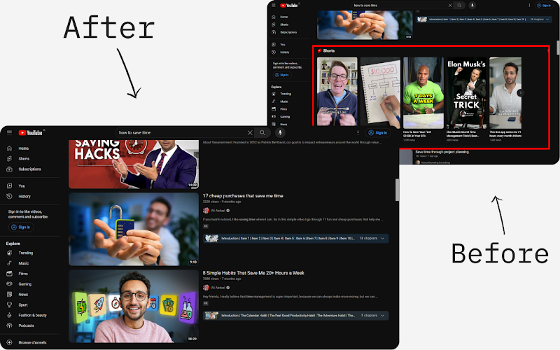

# YouShield

A Chrome and Firefox extension that removes distracting recommendations from YouTube — hiding the homepage feed, suggested videos and Shorts — so you can use the platform without it using you.

**[Chrome Web Store](https://chromewebstore.google.com/detail/youshield-remove-youtube/iohilpdcenclcjbjbebbjgpiimobkpje)** · **[Firefox Add-ons](https://addons.mozilla.org/en-US/firefox/addon/youshield-remove-youtube-short/)**

**1,000+ weekly active users · 4.96★ Chrome Web Store rating**

> **Source code:** This repository documents the current YouShield extension. An earlier implementation (v3) is available under [`legacy-v3`](../../tree/legacy-v3). The current production source remains private.

## What it does

### A cleaner YouTube experience
YouShield replaces YouTube's homepage with a minimal interface containing a search bar and quick access to subscriptions. The recommendation feed stays hidden, allowing users to search for what they want without being presented with an endless stream of suggested videos.

The extension also removes sidebar recommendations, end-of-video suggestions, autoplay prompts and Shorts shelves from search results. Shorts URLs are redirected to standard video pages, avoiding the vertical scrolling feed.

### Consume Mode
YouShield doesn't completely prevent browsing. **Consume Mode** allows users to temporarily restore YouTube's regular interface within a daily viewing-time budget.
Users explicitly set their allowance before entering the mode. Video playback time is tracked, and when the allowance is exhausted, playback stops and the user is returned to the distraction-free homepage.

The extension also removes notification counts from the browser tab title, eliminating another subtle source of distraction.

## Technical Implementation
YouShield is developed using **JavaScript, HTML and CSS**, with Manifest V3 extension architecture and separate configurations for Chrome and Firefox.
The main engineering challenge has been integrating custom functionality into YouTube's complex, dynamic interface without disrupting its existing behaviour.

### Handling YouTube's dynamic navigation
YouTube is a single-page application (SPA), meaning navigating between videos and other pages often happens without a full document reload.
YouShield uses communication between its background component and content scripts to respond to page changes. The content script determines which functionality to activate based on the current URL, using functions such as `initHomepage`, `managePlayer`, `manageShorts` and `manageSubs`.
This separates page-specific behaviour and avoids treating every DOM change as a reason to reinitialise the entire extension.

### Reusing YouTube's native interface
Rather than recreating YouTube's search functionality from scratch, YouShield moves YouTube's existing search form into its custom homepage overlay.
This preserves the original search input, autocomplete suggestions and submission behaviour.
When the user enters Consume Mode, the elements are moved back to their original positions, restoring the normal interface without having to replicate YouTube's internal search logic.

### CSS-driven interface control
Most of the interface modifications are controlled through CSS rather than repeatedly removing or rebuilding DOM elements.
A `consume_mode` attribute is applied to the document's `<html>` element, with selectors such as `html[consume_mode=false]` controlling which parts of YouTube remain visible.
The attribute is set early in page loading to minimise unwanted content appearing before the extension takes effect.
Switching modes requires updating a single attribute, allowing the browser's CSS engine to handle the corresponding interface changes.

### Tracking viewing time
Consume Mode tracks actual video playback rather than simply measuring how long YouTube remains open.
A `timeupdate` listener monitors the HTML `<video>` element and calculates changes in playback position. Only small, positive differences are counted, helping distinguish normal playback from seeking or discontinuities.
The accumulated viewing time is stored in `localStorage` using a date-based key, allowing the daily allowance to reset without requiring a backend service.

### Firebase integration
YouShield integrates Firebase to collect and store feedback submitted by users.
This provides a way to receive suggestions and bug reports from the extension's users and use that feedback to guide further development.

### Cross-browser support
YouShield supports Chrome and Firefox through separate extension manifests.
The Firefox configuration accounts for differences in background script handling, permissions and browser-specific manifest requirements.

## Project Reach
YouShield has been published on the Chrome Web Store since 2023 and has grown to **over 1,000 weekly active users**, with a **4.96-star rating**.
The extension is also available on Firefox Add-ons.
Development has been shaped by maintaining compatibility with YouTube's changing interface, addressing bugs and incorporating feedback from real users.

## Installation
- **Chrome / Edge:** [Install from the Chrome Web Store](https://chromewebstore.google.com/detail/youshield-remove-youtube/iohilpdcenclcjbjbebbjgpiimobkpje)
- **Firefox:** [Install from Firefox Add-ons](https://addons.mozilla.org/en-US/firefox/addon/youshield-remove-youtube-short/)

## Source Code
The current production version of YouShield is **closed-source**.
This repository serves as a project showcase and preserves an earlier implementation under the [`legacy-v3`](../../tree/legacy-v3) Git reference.
The legacy source is available for anyone interested in examining the extension's earlier development, implementation and architecture. It should not be treated as representative of every feature or engineering decision in the current release.
