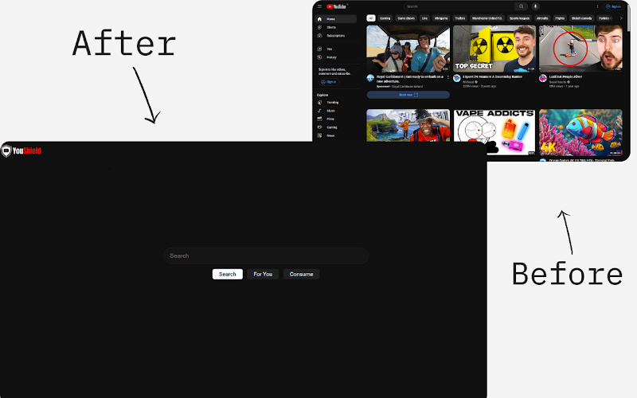
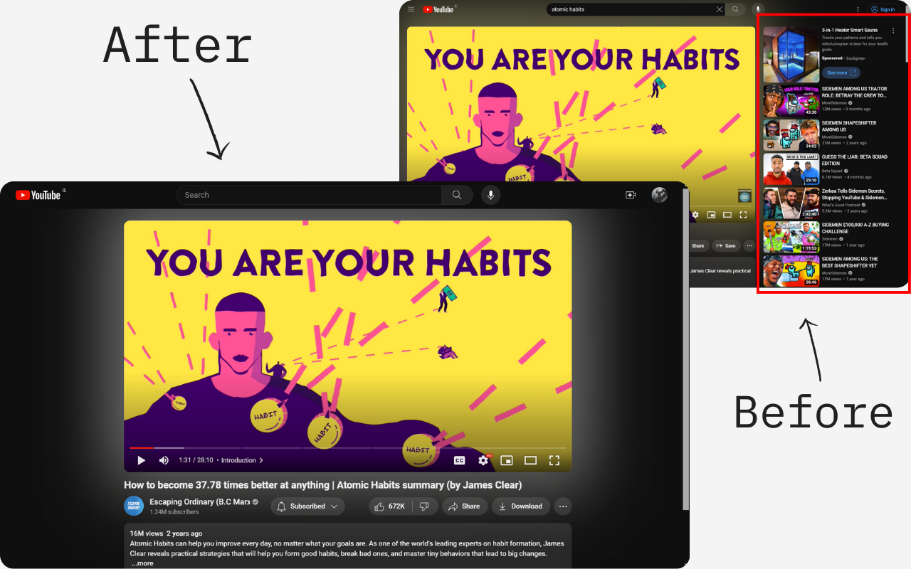
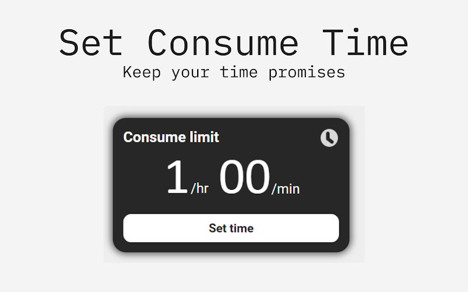

# YouShield

A Chrome and Firefox extension that removes distracting recommendations from YouTube - hiding the homepage feed, suggested videos and Shorts - so you can use the platform without it using you.

**[Chrome Web Store](https://chromewebstore.google.com/detail/youshield-remove-youtube/iohilpdcenclcjbjbebbjgpiimobkpje)** · **[Firefox Add-ons](https://addons.mozilla.org/en-US/firefox/addon/youshield-remove-youtube-short/)**

**1,000+ weekly active users · 4.96★ Chrome Web Store rating**

## What it does

YouShield replaces YouTube's homepage with a minimal interface containing a search bar and quick access to subscriptions. The recommendation feed stays hidden, allowing users to search for what they want without getting distracted.

It also hides sidebar recommendations, end-of-video suggestions, autoplay prompts and Shorts shelves. Shorts URLs are redirected to standard video pages, avoiding the vertical scrolling feed.

### Consume Mode

For times when you want to browse freely, **Consume Mode** temporarily restores YouTube's regular interface within a daily viewing-time budget.

Users set their allowance before entering the mode. The extension tracks video playback time, and once the allowance is exhausted, playback stops and the user returns to the distraction-free homepage.

YouShield also removes notification counts from browser tab titles to reduce distractions.

## Technical Implementation

Built using **JavaScript, HTML and CSS**, with Manifest V3 extension architecture and support for Chrome and Firefox.

The main engineering challenge was integrating custom functionality into YouTube's complex, dynamic interface while preserving its existing behaviour.

- **SPA navigation:** YouTube navigates between pages without full reloads. YouShield uses background-to-content-script messaging to detect navigation and activate page-specific functionality.

- **Native DOM integration:** Rather than recreating YouTube's search functionality, the extension moves the existing search form into its custom homepage. This preserves autocomplete and native search behaviour while allowing the original interface to be restored.

- **CSS-driven interface control:** An attribute on the document's `<html>` element controls CSS selectors that hide or restore interface elements. This avoids repeatedly removing and rebuilding DOM elements, while applying the attribute early helps minimise unwanted content appearing.

- **Playback time tracking:** A `timeupdate` listener monitors the HTML `<video>` element. Small, positive changes in playback position are accumulated, filtering out seeks and avoiding counting paused time. Daily totals are stored locally using `localStorage`.

- **Firebase integration:** Firebase is used to collect and store user feedback, helping identify bugs and guide further improvements.

- **Cross-browser compatibility:** Separate extension manifests accommodate differences between Chrome and Firefox, including background script handling and browser-specific configuration.

## Installation

- **Chrome / Edge:** [Install from the Chrome Web Store](https://chromewebstore.google.com/detail/youshield-remove-youtube/iohilpdcenclcjbjbebbjgpiimobkpje)
- **Firefox:** [Install from Firefox Add-ons](https://addons.mozilla.org/en-US/firefox/addon/youshield-remove-youtube-short/)

## Source Code

The current production version of YouShield is **closed-source**.

An earlier implementation (v3) is preserved under [`legacy-v3`](../../tree/legacy-v3). It provides a reference for the project's earlier architecture and development, but does not represent the complete functionality of the current release.
